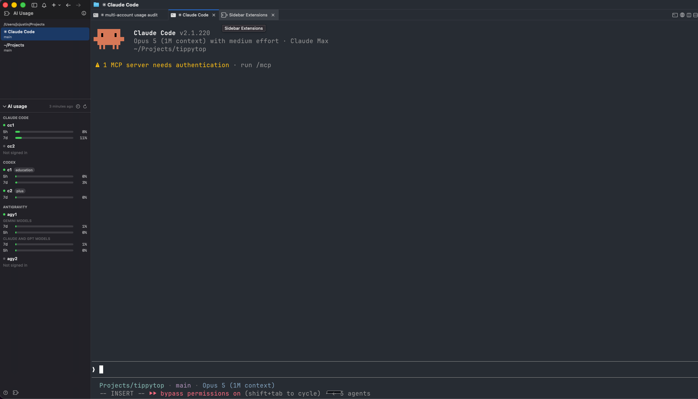
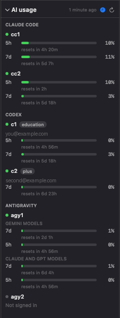

# cmux AI Usage Sidebar

A [cmux](https://github.com/manaflow-ai/cmux) sidebar that shows how much of its
rate limit each local AI agent account has spent. It reads Claude Code, Codex,
Grok, and Antigravity accounts, including second accounts of the same agent.



cmux shows one sidebar at a time, so an extension sidebar replaces the built-in
one. This sidebar therefore also lists the cmux workspaces and switches between
them. Workspaces stay on top, because they are the primary navigation. Usage is
reference data, so it sits below and collapses from its header.

Drag the divider to change how the two halves share the height. Double-click the
divider to fit the workspace list to its rows again.

The clock button discloses more about each account: the signed-in address, and
when each window resets.



A grey dot and "Not signed in" mark an account that has no valid credential.
A bar turns orange above 50 percent and red above 80 percent.

To hide an account, right-click its row and select Hide. A hidden account moves
to a collapsed "Hidden · N" row at the end of the panel. Expand that row and
click Show to bring the account back. See [Hide an account](#hide-an-account).

## Architecture

The project has two components, because a cmux sidebar extension is sandboxed.

```
  aiusaged (LaunchAgent, unsandboxed)          AI Usage Sidebar.appex (sandboxed)
  ├── reads the login keychain                 ├── entitlement: network.client only
  ├── reads ~/.codex*/auth.json                │
  ├── reads ~/.grok*/auth.json                 │
  ├── refreshes the Antigravity token          │
  ├── calls the four usage APIs                │
  └── serves JSON on 127.0.0.1:47823  ────────▶└── polls that URL every 60s
```

The extension cannot read the keychain or the credential files. App Groups need
a provisioning profile that a personal team does not get. An outgoing loopback
socket is the one channel that works with `network.client` alone. The extension
therefore never holds a token.

Manual refresh starts a background collection and returns the current snapshot.
The extension polls locally until collection finishes. Repeated refresh requests
share that collection. Cached timestamps and stale states stay unchanged until
new readings arrive.
The `X-Usage-Refreshing` response header stays `true` while collection runs.

CLIProxyAPI calls have a 60-second timeout because a loopback URL can forward to
a remote host. Pool members are read sequentially. Slow calls are not retried,
and vendor rate-limit cooldowns still apply.

No credential and no usage figure leaves your machine, except in the request
that each agent vendor already receives from its own CLI.

## Requirements

- macOS 14 or newer.
- cmux 0.64.20 or newer. Earlier builds have no sidebar extension point. Run
  `cmux --version` to check.
- Xcode 16 or newer.
- An Apple Development signing identity. A free personal team is sufficient.

## Install with an AI agent

Two parts of the install depend on your machine: your Apple signing team, and
which agent accounts you have. This repository ships a skill that finds both,
and then does the rest.

Copy the skill to your agent's skill directory, then ask for the setup:

```bash
cp -R skills/cmux-ai-usage-setup ~/.claude/skills/
```

Then say: *"set up the cmux AI usage sidebar"*.

The agent reads your certificate for the team ID, finds your accounts, asks what
you call each one, and writes the config. It cannot click the cmux settings
window, so it gives you those four steps at the end.

The skill is plain Markdown at `skills/cmux-ai-usage-setup/SKILL.md`. Any agent
that reads a file can follow it. To install by hand instead, use the steps below.

## Install by hand

Do these steps one time.

### 1. Set your signing team

The project file holds the original author's team ID. You cannot sign with it.
Find your own team ID in Xcode. Open Settings, then select Accounts.
Export the ID before you build:

```bash
export DEVELOPMENT_TEAM=ABCDE12345
```

`install-app.sh` reads this variable. Your checkout stays unmodified.

### 2. Get the cmux SDK

```bash
./scripts/fetch-sdk.sh
```

The script clones cmux and keeps the extension SDK in `vendor/`. cmux has no
package manifest at its root, so SwiftPM cannot fetch the SDK as a remote
dependency.

### 3. Install the daemon

```bash
./scripts/install-daemon.sh
```

The script builds `aiusaged` and installs the binary in `~/.local/bin`. It then
starts a LaunchAgent and waits for the first snapshot. The daemon writes a
default config file at the first start. Step 6 shows how to change that file.

### 4. Install the extension

```bash
./scripts/install-app.sh
```

The script builds the app and copies it to `/Applications`. It opens the app one
time, because macOS finds an extension only after the containing app runs.

### 5. Select the sidebar in cmux

1. Open Settings and select Advanced. Set the Extensions toggle to on.
   The puzzle button stays hidden until this toggle is on.
2. Click the puzzle button. It is adjacent to the sidebar help button.
3. Select Sidebar Extensions and enable AI Usage.
4. Select the extension sidebar provider in the same menu.

Enable one entry only. If the list shows AI Usage more than one time, Launch
Services holds a stale build copy. Run `./scripts/install-app.sh` again. The
script removes the stale copies.

### 6. Check your accounts

The daemon finds your accounts itself. At the first start it writes what it found
to `~/.config/ai-usage/config.json`. To see the same list without a write, run:

```bash
~/.local/bin/aiusaged --discover
```

Discovery reads the login keychain for `Claude Code-credentials*` items. It looks
for `auth.json` under each `~/.codex*` and `~/.grok*` directory. It looks for an
Antigravity token under your home directory and its dot-directories. It names
the first account of each kind plainly and numbers the rest: `claude`,
`claude-2`, `codex`, `codex-2`, `grok`, `grok-2`.

Edit the file for two reasons. Rename an account to what you call it, because
`claude-2` says nothing. Add an account that is signed out, because a store with
no credential in it is invisible to discovery. Then restart the daemon:

```bash
launchctl kickstart -k "gui/$UID/dev.jcsnap.aiusaged"
```

The file wins once it exists. A later scan never overwrites your names. A
versioned migration may append a newly supported provider once; this is how
existing installs gain Grok without replacing their customized accounts.

The file lists one entry per account:

```json
{
  "configVersion": 2,
  "port": 47823,
  "refreshSeconds": 300,
  "accounts": [
    { "id": "cc1", "provider": "claude", "displayName": "cc1",
      "keychainService": "Claude Code-credentials" },
    { "id": "c1", "provider": "codex", "displayName": "c1",
      "codexHome": "~/.codex" },
    { "id": "grok", "provider": "grok", "displayName": "grok",
      "grokHome": "~/.grok" },
    { "id": "agy1", "provider": "antigravity", "displayName": "agy1",
      "home": "~" }
  ]
}
```

Each provider keeps its credential in a different store. The fields differ for
that reason:

| provider | field | credential |
|---|---|---|
| `claude` | `keychainService` | login keychain item |
| `codex` | `codexHome` | `$CODEX_HOME/auth.json` |
| `grok` | `grokHome` | `$GROK_HOME/auth.json` |
| `antigravity` | `home` | `<home>/.gemini/antigravity-cli/antigravity-oauth-token` |

Claude Code derives a keychain suffix from `CLAUDE_CONFIG_DIR`. To find the
service name of a second Claude account, run:

```bash
security dump-keychain | grep -o '"Claude Code[^"]*"' | sort -u
```

### Hide an account

The sidebar hides an account through the daemon, because the sandboxed
extension cannot write a file that the daemon reads. The daemon keeps the list in
`hiddenAccounts` in `~/.config/ai-usage/config.json`, by account `id`:

```json
{
  "accounts": [ ... ],
  "hiddenAccounts": ["cc1", "grok"]
}
```

- The daemon does not read a hidden account. An account that only answers
  HTTP 429 therefore stops using a request each cycle.
- The account stays in `accounts`, with its name and credential store. To show
  it again, click Show in the sidebar, or remove its id from `hiddenAccounts`
  and restart the daemon.
- The list survives a daemon restart and a reinstall of the app or the daemon,
  because both scripts keep the config file.
- Other tools can use `POST /hide/<id>` and `POST /show/<id>` over loopback.
  Hiding returns the updated snapshot. Showing starts a background collection
  and returns the current snapshot until fresh readings arrive.

```bash
curl -s -X POST http://127.0.0.1:47823/hide/cc1 > /dev/null
```

### CLIProxyAPI pools

A [CLIProxyAPI](https://github.com/router-for-me/CLIProxyAPI) pool is one
account in the sidebar that stands for every login of one provider in the
proxy. Set `cliProxyURL` to add one:

```json
{ "id": "cc3", "provider": "claude", "displayName": "cc3",
  "cliProxyURL": "http://127.0.0.1:8317",
  "cliProxyKeyFile": "~/.cli-proxy-api/management-key" }
```

- The daemon reads the management key from `cliProxyKeyFile`. That is also the
  default path.
- The daemon lists the logins with `GET /v0/management/auth-files`. It then
  reads each login through `POST /v0/management/api-call`. The proxy inserts the
  token, so the daemon never reads or refreshes a pooled token.
- Each bar averages fresh readings for that window, including accounts at 100%.
- With the clock on, a pool bar shows how much of the pool frees up instead of
  one reset time, for example `+3% 1h · +11% 2h · +16% 3h · +19% 5h`. Each mark
  is the cumulative share freed by that hour, or by that day for a weekly window.
  A mark that adds nothing is left out. The line wraps when it is too long.
- `avg · 3/7` means three of seven enabled accounts report fresh usage.
  Hover over a bar to see its contributor count. Click the count to show each login.
- The collapsed pool shows how many accounts are not reporting. Stale readings
  remain on individual accounts for up to 24 hours, but never enter the average.
  If no account reports fresh usage, the pool shows an error without average bars.
- `claude` and `codex` pools are supported. Discovery proposes one pool for
  each of them when the management key and an auth file of that provider exist.

### Daily pool burn

After each collection the daemon writes `~/.config/ai-usage/pool-day.json`. It
holds, for each pool, how many accounts of weekly quota the pool spent today.
A status line can read this file instead of calling a usage endpoint.

- Every machine that uses the pool sends its requests through the same logins.
  The burn is therefore the total of all machines, not this machine alone.
- `accountsBurned` is the sum of today's rise in each login's weekly window.
  One login going from 0% to 100% is one account.
- `breakEvenAccountsPerDay` is `memberCount / 7`, the rate at which the pool
  refills. A day above it spends headroom faster than it comes back.
- The day starts at local midnight. Each login's baseline is its reading
  nearest to and not after midnight.
- A daemon that ran in the half hour before midnight uses its own last reading.
- A daemon that missed midnight, because it started late or the laptop slept,
  rebuilds the day from a log that an always-on machine writes. Set
  `poolDaySeeds` to a command that prints that machine's proxy-steer log:

  ```json
  "poolDaySeeds": { "cc3": ["/usr/bin/ssh", "-o", "BatchMode=yes", "-o", "ConnectTimeout=10",
    "jcjustin@devbox", "tail -n 4000 ~/Library/Logs/ai-usage/proxy-steer.log"] }
  ```

  The daemon takes each login's latest logged weekly reading at or before
  midnight, up to 12 hours back. It then replays the logged readings after
  midnight. `weekly 100% used` counts as 1.00. Lines without a weekly figure,
  such as a 5-hour gate or a failed read, are skipped. The command runs only
  while the day is not covered, at most once every 30 minutes, and never calls
  a usage endpoint.
- A weekly reset inside the day adds the rise before the reset. The new window
  then counts from zero.
- A login without a fresh reading keeps its last value. `partial` is then true
  and `missing` names the login.
- `coversDay` is true when every login's baseline is at most 15 minutes after
  midnight. `since` is then midnight. Otherwise `since` is the latest baseline,
  and the burn before it is not counted.
- Usage between the last reading before a reset and the reset is not counted.

### Steer a pool toward logins that reset soon

CLIProxyAPI does not read reset times. Headroom on a login that resets soon is
lost if the proxy does not spend it first. `aiusage proxy-steer` sets each
login's routing weight from the daemon snapshot:

```bash
./scripts/install-proxy-steer.sh                 # pool cc3, every 5 minutes, basis weekly
./scripts/install-proxy-steer.sh --basis tightest
aiusage proxy-steer --dry-run                    # print the planned weights
```

- Set `routing.strategy: "weighted-round-robin"` in the proxy config. Other
  strategies ignore weights. Credential `priority` still wins: only the highest
  priority tier gets traffic, so leave priorities equal.
- `--basis weekly` is the default. Weekly headroom is the scarce resource, so
  the weekly window drives the weight:
  - `weight = 5000 × weekly free share / hours to weekly reset`, at least 5 hours.
  - The 5-hour window is a gate. At 90% or more used the login gets 1.
    Below that the weight is multiplied by `(0.90 − used) / 0.90`.
  - A login whose week-to-date burn rate would spend its weekly headroom before
    the reset is damped by `free / projected use`. The rate is trusted only
    after 24 hours of the week have passed.
  - A login at 95% or more of its weekly window gets 1. A login with no weekly
    window, such as a team seat, uses the tightest rule.
- `--basis tightest` is the older rule: `weight = 250 × headroom / hours until reset`.
  `headroom` is the free share of the fullest window. `hours` is the time to the
  soonest reset, at least 15 minutes. A login at 95% or more of any window gets 1.
- Weights are clamped to 1...1000. A login that answered HTTP 429 gets 1.
- A login without a fresh reading keeps its weight. A snapshot older than 15
  minutes changes nothing.
- Weights are set with `PATCH /v0/management/auth-files/fields`. The proxy saves
  the auth file itself, so the job never reads a token.
- Session affinity keeps a bound session on its login. Only new sessions follow
  the weights.
- The log at `~/Library/Logs/ai-usage/proxy-steer.log` shows emails and weights only.

### Count running agent sessions

`scripts/claude-sessions` counts the running Claude Code and Codex sessions on
one machine, per user. The status line calls it with `--json` on each machine,
so the status line and the table always agree. It runs on macOS and Linux.

```bash
install -m 755 scripts/claude-sessions ~/.local/bin/claude-sessions
claude-sessions          # running counts per user, then one row per session
claude-sessions --json   # the same, for the status line
```

- A session is a `claude` or `codex` process. Daemons, bg-pty-hosts, MCP and
  app servers, and the Codex node launcher do not count.
- A session of the current user with a record in `~/.claude*/sessions/` is
  running when the record says `busy`. `idle`, `waiting` and `shell` are idle.
- Other sessions are running when their process tree used 0.15 CPU seconds in a
  3-second sample. This covers other users' sessions and Codex.
- A firstmate lead is listed, but the counts leave it out.
- The script only lists processes. It does not read another user's home folder.

## Verify

List the accounts this machine has:

```bash
~/.local/bin/aiusaged --discover
```

Print one snapshot without the daemon:

```bash
swift run aiusaged --once
```

Read what the running daemon serves:

```bash
curl -s http://127.0.0.1:47823/ | python3 -m json.tool
```

The daemon writes its log to `~/Library/Logs/ai-usage/aiusaged.log`.

## Endpoints

Each provider exposes usage over its own OAuth token. None of these endpoints is
documented. Each one can change without notice.

| provider | request |
|---|---|
| Claude | `GET api.anthropic.com/api/oauth/usage`, header `anthropic-beta: oauth-2025-04-20` |
| Codex | `GET chatgpt.com/backend-api/wham/usage`, header `chatgpt-account-id` |
| Grok | `GET cli-chat-proxy.grok.com/v1/billing?format=credits` |
| Antigravity | `POST cloudcode-pa.googleapis.com/v1internal:retrieveUserQuotaSummary` |

A few behaviours are easy to misdiagnose:

- Codex ChatGPT access tokens last about ten days. The daemon refreshes them
  through `https://auth.openai.com/oauth/token` with the same client id the CLI
  uses, then writes the rotated tokens and `last_refresh` back into that
  account's `auth.json`. A 401 from the usage endpoint gets one refresh-and-retry.
  If Codex itself already rotated the refresh token, the daemon leaves the file
  alone rather than overwriting a newer session.
- Grok's OAuth refresh can rotate the refresh token. The daemon atomically
  updates only Grok's matching entry in `auth.json`, preserving its other
  profile fields and owner-only file permissions. It shares Grok's adjacent
  `auth.json.lock`, so concurrent CLI and daemon refreshes cannot overwrite one
  another.
- The Antigravity endpoint answers `403 PERMISSION_DENIED` unless the
  `User-Agent` names the antigravity client. That is client sniffing, not a
  missing OAuth scope.
- A logged-out Claude profile still has a keychain item. That item holds only
  `mcpOAuth`. Its presence is not proof of a login.

Antigravity needs one more thing: only the OAuth client that issued a refresh
token can refresh it. That client belongs to the Antigravity CLI, so this project
reads it out of the installed `agy` binary rather than keeping a copy. The binary
holds more than one client, so each candidate is tried once and the pair that
works is cached at `~/.config/ai-usage/antigravity-client.json`. Set
`ANTIGRAVITY_CLIENT_ID` and `ANTIGRAVITY_CLIENT_SECRET` to override the search.

Antigravity also names its windows in words. `weekly` becomes `7d` at the fetch
layer, so one column width fits every provider.

## Permissions

The extension asks cmux for the least it needs to draw the workspace list:

| scope | use |
|---|---|
| `workspaceList` | workspace identity and order |
| `workspaceMetadata` | title, branch, unread count, current selection |
| `workspacePaths` | project root headings and row subtitles |
| `selectWorkspace` | switch workspace when you click a row |

The extension never asks for surfaces, notifications, ports, or pull requests.
Usage data does not come through cmux at all. It comes from the daemon.

## Develop

```bash
swift build && swift test          # daemon
./.build/debug/aiusaged --once     # print one snapshot and exit
./scripts/sync-models.sh           # after you edit Sources/UsageModels
```

The extension target keeps a generated copy of the wire types, because it is a
separate Xcode target and cannot link the SwiftPM library. `sync-models.sh`
copies them. Do not edit the generated file.

Add a provider in four steps. Add a case to `UsageProvider`. Add a client that
conforms to `UsageProviderClient`. Add the credential field to `AccountConfig`.
Add a scan for that credential to `Discovery`, so the new provider needs no
hand-written config either.

## Layout

```
Sources/UsageModels     wire types, shared by both sides
Sources/UsageFetch      credential access and provider HTTP
Sources/aiusaged        refresh loop and loopback server
AIUsageSidebar/         Xcode project: containing app + sidebar extension
scripts/                install and helper scripts
skills/                 setup skill for an AI agent
vendor/CmuxExtensionKit copy of the cmux extension SDK
```
